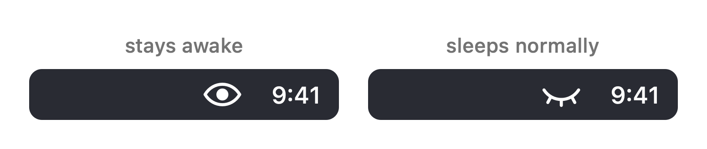

# Uyku

An eye in your Mac's menu bar that shows whether the Mac is allowed to sleep.



- **Open eye:** the Mac stays awake, even with the lid closed.
- **Closed eye:** the Mac sleeps normally.

Click the eye to switch. That is the whole app.

It is meant for the times you want a MacBook to keep working with the lid shut: a long download, a backup, a build, an AI agent running overnight. *Uyku* is Turkish for "sleep".

## Install

Paste this into Terminal:

```bash
curl -fsSL https://raw.githubusercontent.com/sahintekten/uyku/main/install.sh | bash
```

The script downloads the source, builds the app on your Mac and puts it in `~/Applications`. Building needs Apple's Command Line Tools; if they are missing, the script starts their installer and asks you to run it again afterwards.

Prefer to read the code first? Clone the repository and run the same script:

```bash
git clone https://github.com/sahintekten/uyku.git
cd uyku
./install.sh
```

Requires macOS 13 or later.

## Use

| | |
|---|---|
| Click | Switch between "stays awake" and "sleeps normally" |
| Right-click | Options |

Options:

- **Icon:** eye, emoji faces, sun and moon, or a plain switch.
- **Don't ask for my password:** see below.
- **Start at login:** bring the eye back after every restart.

## The password

Changing the sleep setting needs administrator rights, so macOS asks for your password on the first click. With that same prompt Uyku adds a rule to `/etc/sudoers.d/uyku` that lets your user run exactly two commands without a password, so it never asks again:

```
pmset -a disablesleep 0
pmset -a disablesleep 1
```

Nothing else is allowed by that rule. To be asked every time instead, right-click the eye and turn off **Don't ask for my password**; the rule is deleted.

## Keep in mind

A Mac that cannot sleep keeps running in a closed bag. It gets hot and drains the battery. Close the eye before you pack the Mac away.

As a safety net, Uyku checks the battery once a minute. On battery power at 10% or less, it lets the Mac sleep again if the passwordless option is on, and warns you if it is not.

## How it works

Uyku runs `pmset -a disablesleep 1` and `pmset -a disablesleep 0`, the same switch you could flip yourself in Terminal, and reads the current value back every few seconds. If you change the setting some other way, the eye follows.

The whole app is one file: [`Sources/main.swift`](Sources/main.swift).

## Uninstall

```bash
curl -fsSL https://raw.githubusercontent.com/sahintekten/uyku/main/uninstall.sh | bash
```

This removes the app, turns normal sleep back on and deletes the passwordless rule if you added it.

## Türkçe

Menü çubuğunda bir göz: açıksa Mac uyumaz (kapağı kapatsan da), kapalıysa normal uyur. Göze tıklayınca durum değişir.

Kurmak için Terminal'e şunu yapıştır:

```bash
curl -fsSL https://raw.githubusercontent.com/sahintekten/uyku/main/install.sh | bash
```

Parolayı yalnız ilk tıklamada bir kez sorar, sonra bir daha sormaz. Sağ tıklayınca simgeyi değiştirebilir, istersen parolanın her seferinde sorulmasını açabilir ve gözün her açılışta kendiliğinden gelmesini sağlayabilirsin. Mac'in dili Türkçeyse menü de Türkçe çıkar.

Uyumayan Mac kapalı çantada ısınır ve pili bitirir; Mac'i çantaya koymadan önce gözü kapat.

## License

[MIT](LICENSE)
